[](#beta-status)
[](https://github.com/Looted/kibi/actions/workflows/ci.yml)
[](https://codecov.io/gh/Looted/kibi)
[](https://looted.github.io/kibi/kibi-report/)
[](LICENSE.md)
[](https://glama.ai/mcp/servers/Looted/kibi)
[](https://x.com/kibi_dev)

**Prompt the intent. Kibi makes the agent remember it—and prove the implementation.**



<sub>Simplified from what Kibi reports in each case.</sub>

Kibi is an agent-native requirements compiler and enforcement layer. You describe product intent in natural language; the agent creates and maintains the structured requirements, scenarios, tests, semantic facts, and code links. Kibi then checks that the implementation remains coherent with that intent.

Unlike passive memory or retrieval systems, Kibi is designed to place itself in the agent's workflow. The agent does not have to remember to consult a ticket, board, or requirements folder: Kibi's hooks, tools, and validation gates continuously bring the relevant product context back into the work.

**[Documentation](https://looted.github.io/kibi/)** · **[Quick start](https://looted.github.io/kibi/guide/quick-start.html)** · **[Kibi's own health report](https://looted.github.io/kibi/kibi-report/)**

## Why Kibi

Most project knowledge is scattered across prompts, tickets, code, and conversations—and most AI agents eventually forget part of it. Kibi turns that knowledge into an enforceable, branch-local model:

- **Humans maintain intent, not artifacts** — The prompt is the primary authoring interface. Agents own the routine work of creating and evolving requirements, scenarios, tests, facts, and symbol links; humans resolve genuine ambiguity and product decisions.
- **Memory is enforceable** — Symbols need requirement ownership, requirements need complete semantics and scenarios, scenarios need tests, and proof-bearing tests need fresh execution evidence.
- **Prolog guards against drift** — Typed properties, predicates, and safe rules let deterministic checks expose contradictions, unsupported invention, and incomplete semantics before they become accepted project knowledge.
- **E2E behavior is traceable** — Kibi records what an end-to-end test proves, not merely which lines it happened to execute. You can navigate from a symbol to its requirement or from a test to the scenario and intent it verifies.
- **Intent survives branch changes** — Each Git branch has its own KB snapshot, so feature context stays isolated and is there when you return.
- **Works across languages** — TypeScript and JavaScript symbols are built in. The optional [`kibi-plugin-treesitter`](https://looted.github.io/kibi/reference/plugins.html) adds offline symbol extraction for Python, Go, Rust, Java, C#, PHP, C, C++, Bash, Ruby, and Terraform/HCL using pinned WASM grammars.
- **Optional UI design guard (experimental)** — [`kibi-plugin-ui`](https://looted.github.io/kibi/reference/plugins.html#optional-ui-design-plugin) keeps React and Angular components on their agreed design patterns. Pixels, colours and spacing stay with your linter.
- **Keep knowledge local** — KB state lives in your repository's `.kb/` directory; the Kibi packages send no external telemetry or analytics. Only the documentation website counts visits, with cookieless [Umami](https://umami.is) analytics.

## Quick start

Kibi is meant to be set up and driven by your coding agent, so the recommended install is a prompt rather than a list of commands. Kibi requires **Node.js 22+**. SWI-Prolog is bundled: on Linux (x64 or arm64, glibc 2.28+) and macOS (Apple silicon or Intel) there is nothing else to install. On other platforms, such as Alpine/musl or native Windows (use WSL), install SWI-Prolog 9.0+ and put `swipl` on your `PATH` ([details](https://looted.github.io/kibi/guide/install.html)).

**Recommended: let your agent set it up.** Paste this into Claude Code, Cursor, Codex, OpenCode, or any coding agent that can run commands in your repository:

```prompt
Set up Kibi (https://github.com/Looted/kibi) in this repository, then bootstrap its knowledge base.

1. Install: confirm Node.js 22+ is available. With the package manager this repository already uses, add kibi-core, kibi-cli and kibi-mcp as dev dependencies. Do not skip optional dependencies; the bundled SWI-Prolog runtime is one.
2. Initialize: run every `kibi` command through the package manager's local runner (npm: `npm exec -- kibi <command>`). Run `kibi init`; if it reports a problem, run `kibi doctor` and fix what it names. If this platform has no bundled SWI-Prolog, tell me what to install and stop.
3. Connect: register the project-local `kibi-mcp` server for the agent host you are running in, following https://looted.github.io/kibi/guide/connect-an-agent.html. Prefer project-scoped configuration, and ask me before installing a plugin or changing global settings. Until the kb_* tools are visible to you, use Kibi's CLI JSON routes instead.
4. Bootstrap: run `kibi skills load kibi-bootstrap --format markdown` and follow that skill exactly. It starts by asking me where product intent lives outside the code (issue trackers, wikis, specs) and which sources to trust; read them through the connectors you have and cite them. Show me the complete plan and its hash, and write nothing until I approve it.
5. Verify: run `kibi check` and `kibi status`, fix anything they report, and summarize what was added. Do not commit; I will review the changes.
```

What happens next:

1. **Setup.** The agent installs the packages, runs `kibi init`, and connects itself to Kibi.
2. **Interview.** It asks where your product intent already lives (issue trackers such as Jira or YouTrack, wikis, specs) and which of those sources to trust.
3. **Plan.** It reads those sources through the connectors it has and drafts a bootstrap plan. Every requirement in the plan cites the ticket or page it came from. Open questions and conflicts it finds between sources are flagged for you rather than turned into requirements.
4. **Your approval.** It shows you the plan and its hash. Nothing is written until you approve.
5. **Apply and check.** It applies the plan, validates the result, then fills in what the plan could not write, such as scenarios from acceptance criteria and machine-checkable facts for the new requirements. It tells you what it added.

After that, work normally: prompt for features, fixes, and refactors, and the agent keeps requirements, scenarios, tests, and code links in step with the code.

<details>
<summary>Manual installation</summary>

In your repository:

```bash
npm install --save-dev kibi-core kibi-cli kibi-mcp
npm exec -- kibi init
```

`kibi init` creates the `.kb/` layout and installs the Git hooks that keep it in sync. It never overwrites a hook it did not write, and it does not infer product knowledge. [Connect your coding agent](#connect-your-coding-agent), then ask it:

> **Bootstrap Kibi for this repository.**

pnpm, Yarn, and Bun work the same way through their local runners. The [installation guide](https://looted.github.io/kibi/guide/install.html) has their equivalents, how Kibi finds SWI-Prolog, and package-manager caveats. `npm exec -- kibi doctor` tells you whether everything is in place.

</details>

**Upgrading.** After updating the Kibi packages, run `kibi migrate` (or ask your agent to). It shows what would change and applies nothing until you approve; the [CLI reference](https://looted.github.io/kibi/reference/cli.html#kibi-migrate) covers each schema version.

## Connect your coding agent

The setup prompt above does this step for you. To do it by hand: every client starts the same project-local `kibi-mcp` server (`npx --no-install kibi-mcp`, stdio, working directory = your repository). Optional plugins add bundled skills and hooks on top.

<details>
<summary>Claude Code</summary>

Install the optional `kibi-claude` plugin from this repository's marketplace. It brings the MCP server, the bundled skills, and hooks that show the agent the linked requirements, what they must keep true, and the decision behind them before it reads or edits code, including through shell commands. The [agent connection guide](https://looted.github.io/kibi/guide/connect-an-agent.html) has the details:

```bash
claude plugin marketplace add Looted/kibi
```

```bash
claude plugin install kibi-claude@kibi
```

Without the plugin, register the server for the project:

```bash
claude mcp add --scope project kibi -- npx --no-install kibi-mcp
```

</details>

<details>
<summary>Cursor</summary>

Add Kibi to `.cursor/mcp.json`:

```json
{
  "mcpServers": {
    "kibi": {
      "command": "npx",
      "args": ["--no-install", "kibi-mcp"]
    }
  }
}
```

The optional `kibi-cursor` plugin adds rules, bundled skills, commands, and advisory hooks that show the same requirement context as the Claude Code plugin before reads and edits of linked code. See the [Cursor plugin guide](https://looted.github.io/kibi/guide/install.html#optional-cursor-plugin).

</details>

<details>
<summary>Codex</summary>

```bash
codex mcp add kibi -- npx --no-install kibi-mcp
```

The optional `kibi-codex` plugin bundles Kibi skills, MCP configuration, and warning-only hooks that bring the linked requirement into the agent's context before it changes code. Add the Kibi repository marketplace, open Codex, then run `/plugins`, choose **Kibi Plugins**, and install `kibi-codex`:

```bash
codex plugin marketplace add Looted/kibi
```

The repository marketplace is not the official OpenAI Plugin Directory; self-serve plugin publishing is not available there yet. Manual MCP configuration remains fully supported.

</details>

<details>
<summary>OpenCode</summary>

Add Kibi to `opencode.json`. The optional `kibi-opencode` plugin adds prompt guidance (including what a requirement linked to the file being edited must keep true) and background maintenance:

```json
{
  "mcp": {
    "kibi": {
      "type": "local",
      "enabled": true,
      "command": ["npx", "--no-install", "kibi-mcp"]
    }
  },
  "plugin": ["kibi-opencode"]
}
```

</details>

<details>
<summary>VS Code</summary>

Add Kibi to `.vscode/mcp.json`:

```json
{
  "servers": {
    "kibi": {
      "type": "stdio",
      "command": "npx",
      "args": ["--no-install", "kibi-mcp"]
    }
  }
}
```

</details>

<details>
<summary>ZCode and other MCP clients</summary>

Any stdio MCP client works with `command: npx`, `args: --no-install kibi-mcp`. ZCode also has an optional plugin, installed from a local checkout, whose edit hook shows the same requirement context as the Claude Code plugin; see the [ZCode plugin guide](https://looted.github.io/kibi/guide/install.html#optional-zcode-plugin). Agents without MCP can use the same operations through the CLI's JSON routes.

</details>

### What your agent gets

Kibi's skill subsystem gives the agent six bundled skills that teach it how to work with Kibi, so you do not paste a long system prompt, and a small set of MCP tools does the rest:

- **Plain-language answers.** Ask "what governs checkout rounding?" and `kb_search` returns the current requirements, the tests and decisions behind them, and what Kibi's checks say about each.
- **A review of every change.** `kb_check` on the files the agent touched quotes the requirements that code implements and flags new code no requirement covers.
- **Safe writes.** Every write can be previewed first, and a plan you approve lands in full or not at all.

The [MCP reference](https://looted.github.io/kibi/reference/mcp.html) lists every tool. Generic agents can start from [agent onboarding](https://looted.github.io/kibi/reference/agent-onboarding.html).

## See how strong each guarantee is

```bash
npm exec -- kibi report --open
```

`kibi report` writes a self-contained `kibi-report/index.html` and `kibi-report/badge.svg` from one coverage snapshot. `% tested` is the share of current requirements with fresh end-to-end evidence on the current code; the report lists what is tested, what is missing evidence, what contradicts, and what has gone stale.

Every requirement also carries an evidence level, so no guarantee reads stronger than what backs it: **proved** (a re-checkable certificate covers every case; no proof kind issues one yet), **tested** (fresh end-to-end receipts cover every linked scenario), **asserted** (a person stands behind it, but nothing current checks it) and **unverified** (an agent wrote it and no person approved it). `kibi coverage` returns `evidenceLevel` per requirement and `summary.evidenceLevels` counts; the report and `kibi signoff` show it next to firmness. See [the proof ladder](https://looted.github.io/kibi/guide/proof-ladder.html). See [reading the report](https://looted.github.io/kibi/guide/reading-the-report.html).

The knowledge base itself is checked the same way. `npm exec -- kibi verify` proves that the facts your requirements state are consistent (one value satisfies every fact on a property, every decision has one outcome) and that stored rules are stratified, and leaves a certificate for each answer that a small separate checker re-checks. It also catches facts that contradict only together, which pairwise checks miss. A contradiction comes back as the smallest set of facts that cannot hold at once; anything it cannot compare is reported as unresolved, never as consistent.

Before you sign off on a change, `kibi signoff` shows the requirements it adds, rewrites or affects, each quoted with its firmness, proof state and evidence level, and `kibi signoff --questions` numbers the decisions waiting for you next to the rule each one would change. Agents put the view in their reply as plain Markdown, so it renders wherever the agent writes, including chat apps and cloud sessions where replies go through a messaging tool; the same view is a self-contained page in `.kb/briefs/signoff/latest.html`. Claude Code, Cursor, ZCode and OpenCode add a `/kibi-signoff` command, OpenCode draws the view as a card, VS Code opens it in a panel, and the agent hooks ask for it once a session has written requirements.

To publish the report and a clickable badge on GitHub Pages, run `npm exec -- kibi init --github`, then enable **Settings → Pages → Source → GitHub Actions**. The [GitHub integration guide](https://looted.github.io/kibi/guide/github-integration.html) covers the [report workflow](docs/examples/github/kibi-report.yml), badge-only publishing, and a [CI step](docs/examples/github/kibi-kb-merge.yml) that keeps pull requests mergeable when only Kibi's own files conflict.

For day-to-day inspection, `kibi status`, `kibi search`, `kibi gaps`, `kibi coverage`, and `kibi check` are in the [CLI reference](https://looted.github.io/kibi/reference/cli.html).

## How it works

Kibi combines probabilistic interpretation with deterministic verification:

```text
Human prompt
    |
    v
Agent updates code and product knowledge
    |
    v
Requirements + semantic facts/rules + scenarios + tests + symbol links
    |
    v
Prolog coherence checks + traceability gates + fresh E2E evidence
    |
    v
Tested result or explicit, repairable gaps
```

The agent never writes arbitrary Prolog as trusted truth. It works through typed facts, predicate schemas, and safe logic representations; Kibi validates those encodings before the Prolog layer uses them for inference.

### What Kibi enforces

Kibi maintains a canonical traceability and proof chain:

```text
Requirement -> Scenario -> Test
     ^                       ^
     |                       |
 Production symbol     Executable test symbol
```

For a requirement to be tested end to end rather than merely documented:

- Every production symbol must trace to the requirement it implements.
- Every normative requirement clause must be modeled as typed facts or stay explicitly unresolved.
- Requirements must be specified by scenarios, and tests must verify those scenarios. A success scenario that assumes something a current requirement forbids blocks proof.
- Executable test symbols must identify the code that actually performs the verification.
- Proof-bearing production symbols must be covered by qualifying tests, and the pre-commit hook applies the same rule as the full check.
- End-to-end evidence must be fresh and bound to the current code snapshot, so CI and a local checkout of the same commit agree.

That makes questions answerable in both directions: which requirement owns this symbol, what this E2E test actually verifies, which requirements lack a scenario or current evidence, and whether two current requirements contradict each other. Code coverage alone cannot answer them: it shows that a test touched a line, not which product behavior was exercised.

### Prolog as the safety layer

Suppose the product defines exactly three user roles. Once that constraint is encoded as a strict property or predicate, an agent cannot quietly invent a fourth role and treat it as established intent: Kibi can surface the contradiction or missing authorization deterministically.

Kibi does not report "no conflict" when it could not tell. Numeric constraints are compared exactly ("greater than 0" conflicts with "equals 0"), an allow and a deny for the same action contradict, and anything Kibi cannot model is reported as unresolved for the agent to review, never as a clean pass.

Prolog does not decide whether the original human intent was correct. It verifies the knowledge that was encoded, while Kibi keeps ambiguity, missing ontology, incomplete grounding, and stale evidence explicit instead of calling them proof.

### Why this is possible now

Traditional knowledge bases required specialists to design ontologies, write formal logic, and maintain every mapping by hand. LLMs change the economics of that authoring step, and Kibi and Prolog supply the discipline:

| Participant | Strength and responsibility |
| --- | --- |
| Human | States product intent and resolves real ambiguity or policy choices |
| AI agent | Maps intent to the codebase and maintains requirements, scenarios, tests, facts, and symbol links |
| Kibi + Prolog | Validates schemas, checks coherence and contradictions, enforces traceability, and evaluates proof evidence |

The result uses LLM strengths to address LLM weaknesses: limited memory, hallucination, context drift, and the loss of the product-to-code mapping traditionally spread across product owners, ticket systems, and planning boards.

### What Kibi models

Eight entity types: `req`, `scenario`, `test`, `fact`, `adr`, `flag`, `event`, and `symbol`. The [entity schema](https://looted.github.io/kibi/reference/entity-schema.html) has the complete model.

Every entity records who authored it, a person or an agent, and advisory checks list agent-written requirements no person has approved.

Requirements and ADRs also say how firmly they were decided. A `firm` rule is one a person stated: it points at their words, the agent asks before changing it, and Kibi refuses to rewrite it quietly. A `default` choice can be revisited on evidence, and `exploratory` marks a guess. Every supersede has to say why it changed. [How Kibi works](https://looted.github.io/kibi/guide/how-it-works.html) has the details.

## Packages

Install `kibi-core`, `kibi-cli`, and `kibi-mcp` in the project. Everything else is optional.

| Package | Role |
| --- | --- |
| `kibi-core` | Prolog-backed knowledge graph, inference, and validation |
| `kibi-cli` | Human, agent, automation, and Git-hook interface |
| `kibi-mcp` | MCP surface exposing the public Kibi operation contracts |
| `kibi-claude` | Claude Code skills, MCP, requirement context before reads/edits, and advisory hooks (plugin marketplace) |
| `kibi-cursor` | Cursor rules, skills, MCP, requirement context before reads/edits, and advisory hooks |
| `kibi-codex` | Codex skills, MCP, requirement context before edits, and lifecycle hooks |
| `kibi-opencode` | OpenCode guidance (including requirement context for edits) and background maintenance |
| `kibi-zcode` | ZCode skills, command, MCP, requirement context before edits, and advisory hooks (local checkout) |
| `kibi-vscode` | VS Code knowledge explorer and traceability view |
| `kibi-plugin-sdk` | Protocol types and validators for [capability plugins](https://looted.github.io/kibi/reference/plugins.html) |
| `kibi-plugin-builtin` | Default semantic, ontology, and TypeScript symbol capabilities |
| `kibi-plugin-jev` | Optional TypeSafe Jev semantic classifier |
| `kibi-plugin-treesitter` | Optional offline multi-language symbol extraction (tree-sitter WASM grammars) |
| `kibi-plugin-ui` | Experimental check policy keeping UI components on their agreed design patterns |
| `kibi-swipl` | Bundled SWI-Prolog runtime; the matching platform build installs automatically |

## Documentation

The guide and reference are published at **<https://looted.github.io/kibi/>**. Language models can start from the [documentation index](https://looted.github.io/kibi/llms.txt).

- [Installation](https://looted.github.io/kibi/guide/install.html) — the bundled SWI-Prolog runtime, package managers, plugins, and verification
- [How Kibi works](https://looted.github.io/kibi/guide/how-it-works.html) and [the proof ladder](https://looted.github.io/kibi/guide/proof-ladder.html)
- [Proving requirements](https://looted.github.io/kibi/reference/proving.html) — proof contracts, `kibi prove`, and receipts
- [CLI reference](https://looted.github.io/kibi/reference/cli.html) and [MCP reference](https://looted.github.io/kibi/reference/mcp.html)
- [Entity schema](https://looted.github.io/kibi/reference/entity-schema.html) and [inference rules](https://looted.github.io/kibi/reference/inference-rules.html)
- [Architecture](https://looted.github.io/kibi/reference/architecture.html) — storage, branch isolation, and data flow
- [Troubleshooting](https://looted.github.io/kibi/guide/troubleshooting.html)

## Beta status

Kibi is in beta and ready for use in real projects. Public interfaces may still evolve before 1.0, so pin exact package versions when reproducibility matters.

Kibi is licensed under [AGPL-3.0-or-later](LICENSE.md).
