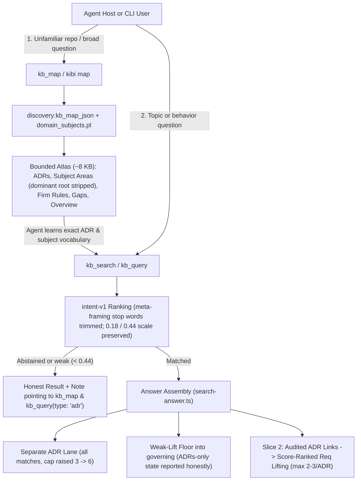

# Architecture RFC v2: Repository Orientation and Natural-Language Retrieval in Kibi

**Status:** Proposed Architecture Plan v2 (Revised After Empirical Review) — Ready for Implementation Planning  
**Date:** 2026-11-23  
**Supersedes:** Architecture RFC v1 (`nl-retrieval-and-orientation.md`, initial draft)  
**Target Scope:** `kibi-core`, `kibi-cli`, `kibi-mcp`, `kibi-runtime`, `kibi-agent-core`, host adapters, skills, and docs  
**Related Existing ADRs & Requirements:**
- `ADR-022` (MCP and CLI are peer public operation surfaces)
- `ADR-026` (Canonical `.kb/` project contract)
- `ADR-capability-plugins-v1` (Bounded capability plugins `kibi.plugin.v1`)
- `ADR-discovery-tools-public-surface` (Discovery tools expand public read surface without exposing raw inference)
- `REQ-kibi-intent-aware-source-discovery` (Lexical, facet, source, and graph discovery with abstention)
- `REQ-kibi-search-answer-layer-v2` (Current `kibi.search-answer.v1` answer layer contract)
- `REQ-kibi-search-hints-when-asked`, `REQ-kibi-search-hints-limits` (`firm`: `0.44` / `10` / `20` / `50`), `REQ-search-hints-model-pin` (`firm`), `REQ-search-hints-host-operations` (`firm`)
- `REQ-kibi-mcp-tool-catalog` (`firm`: 19 default tools), `REQ-kibi-mcp-tool-consolidation`, `REQ-kibi-operation-catalog-names`
- `REQ-kb-domain-subject-layer`, `REQ-kb-domain-subject-view`
- `REQ-kibi-bootstrap-seed-and-handoff` (`firm`), `REQ-kibi-bootstrap-knowledge-sources`

---

## 1. Executive Summary & What Changed from v1 to v2

Following a comprehensive empirical review against `develop` (`a00d3513`) and maintainer design decisions, this v2 plan replaces the heavy v1 retrieval overhaul with a **lean, zero-dependency Tier-0 architecture** built in two small slices, while deferring speculative ML/indexing machinery until measured evidence on a conceptual gold set proves a remaining gap.

### Locked Maintainer Decisions
1. **Dedicated `kb_map` Tool (`kibi map` CLI peer):** Ship `kb_map` as the 20th default MCP tool (rather than overloading empty `kb_query({})`) so orientation is immediately discoverable across tool catalogs, host hooks, and CLI help, with explicit maintainer approval to supersede `REQ-kibi-mcp-tool-catalog` (`firm`, `19 -> 20`).
2. **Product Positioning — Governance Orientation, Not a General Repo Tour:** Frame `kb_map` narrowly and truthfully around Kibi's core mission: *"the architectural decisions, firm rules, subject vocabulary, and ungoverned gaps you must respect here"*—not a generic wiki/code tour.
3. **Bootstrap Overview Stored as a Non-Firm Observation Fact:** Persist `bootstrapContext.projectSummary` as a standard `observation` fact tagged `kb:project-overview` (non-firm, **outside** the `subject` ancestry tree), avoiding root-prefix contradiction-pairing explosions and firm-edit friction.

### What Was Cut or Deferred from v1 (and Why)
- **Cut: Persistent derived card index & latency claims.** Synchronous `.md` body reads across Kibi's KB take ~35 ms out of ~3.2–3.4 s total CLI search latency; the actual latency sits in Prolog answer verdicts, candidate paging, and graph edges. A second branch/snapshot-synchronized index solves a non-bottleneck.
- **Cut: Replacing `intent-v1` scoring with BM25F + adaptive channel weights.** Because `repo-search-gold.v4.jsonl` already consists of plain NL queries without `sourceLocations` or `semanticFacets`, the `0.58` lexical ceiling is already priced into the `0.18` acceptance threshold and firm `0.44` hint cutoff. Replacing the scoring scale invalidates calibrated thresholds without measured need.
- **Cut: English phrase-list question routing.** Breaks non-English KBs while the rest of Tier 0 stays language-neutral.
- **Cut: Replacing the full search pool with Governance Cards.** Would hide 40 observation facts, 9 meta facts, negative-path facts (*"what is forbidden"*), 719 `assumes`-only facts, and 583 tests without direct requirement links.
- **Deferred (data-gated): `kibi.semantic-retrieval.v1`, ONNX bi-encoder/cross-encoder plugin, LLM reranker, `kibi ask`, and `search-answer.v2`.** In five of six Kibi setups, the caller is already a frontier LLM that reranks far better than a small local cross-encoder once shown the KB's vocabulary. Any semantic tier waits until the conceptual gold set (scored on both single-shot and 2-call orientation + search workflows) shows an actual remaining gap—followed first by a throwaway spike rather than premature SDK/packaging commitments.

> **Branch/Checkout Context Note:** Clean `develop` (`a00d3513`) gates on `repo-search-hints-gold.v2.jsonl` (25 questions) and lists Claude Code, Codex, Cursor, OpenCode, ZCode, and hostless CLI in `AGENTS.md`. This local checkout contains pre-existing uncommitted `packages/antigravity/` work and `repo-search-hints-gold.v1.jsonl`. Implementation will verify and pass against the target branch's live gold sets and all supported hosts.

---

## 2. Problem Statement & Empirical Reality

When a user bootstraps Kibi or opens an unfamiliar repository and asks an agent to use Kibi to understand what governs the repository, `kb_search` currently fails on open-ended natural-language questions.

### 2.1 Reproduced Failure Traces on Kibi's Own KB (~5,900 Entities)

Three natural-language questions tested on Kibi's `develop` KB (`snapshotId: generation-60-1795286092996:524`) reproduced identically across both the RFC author and the independent reviewer:

1. **Experiment 1 — Broad Principles Listing Request:**  
   *Query:* `"What are the main design principles and architectural decisions in Kibi?"`  
   *Result:* `intent-v1` returned `count: 0`, `abstained: true` across ~5,905–5,946 candidates. `kibi-plugin-search-hints` (`potion-base-8M`) fired on abstention and returned 10 noisy hints led by `REQ-kibi-skills-write-without-ritual` (`0.718` via `SYM-kibi-decisions-skill-guidance`), adapter package reqs, and proof-regex tests—and **zero ADRs**.
2. **Experiment 2 — Repository Structure & Package Overview:**  
   *Query:* `"What is the overall architecture of this repository and how are packages structured?"`  
   *Result:* Top 4 ranked matches were ADRs (`ADR-019`, `ADR-025`, `ADR-capability-plugins-v1`, `ADR-013`), while `ADR-006` (*Monorepo structure*) missed lexically and sat at hint #4. Worse, `answer.governing` contained **only** `REQ-mcp-structured-text-per-host`, lifted from rank #5 `TEST-mcp-structured-text-per-host` (`0.204`).
3. **Experiment 3 — Paraphrased Subsystem Question:**  
   *Query:* `"How does Kibi store data and ensure consistency when multiple processes write?"`  
   *Result:* `SCEN-opencode-python-comment-routing` ranked #3 (`0.312`) and polluted `answer.governing` with `REQ-opencode-comment-routing`; `ADR-024` (*Journaled single-writer engine*) landed at rank #10 (`0.208`) and was **dropped from `answer.rationale`** because `SEARCH_ANSWER_LIMITS.rationale` is `3`. `REQ-kibi-engine-durable-transactions` never appeared.

### 2.2 The Decisive Counter-Experiment: Vocabulary, Not Ranking, Is the Primary Bottleneck

When the reviewer re-asked Experiment 3 and Experiment 2 using the KB's own terminology—**with zero code changes**—today's `intent-v1` search succeeded immediately:
- `"journaled single-writer engine persistence and concurrent writers"` → returned `ADR-024` at #1 (`0.48`) and put `REQ-kibi-engine-durable-transactions` and `REQ-kibi-engine-single-writer-protocol` into `answer.governing`.
- `"monorepo package structure"` → returned `ADR-006` at #1 (`0.58`).

Because the caller in agent-hosted sessions is already a frontier LLM, **exposing the repository's vocabulary, accepted ADRs, and firm rules cheaply—and stopping `kb_search` from returning misleading weak lifts—solves the core workflow directly.**

### 2.3 Hypotheses Rejected by Measurement

| v1 Hypothesis | What Measurement Showed | Decision in v2 |
| :--- | :--- | :--- |
| Synchronous `.md` body reads dominate 2–3 s search latency. | Reading all 5,938 KB Markdown files synchronously takes **35 ms** out of ~3.2–3.4 s total CLI search time. Time is spent in Prolog answer verdicts, candidate paging, and graph edges. | **Cut** persistent derived card index; profile Prolog steps first if latency becomes a priority. |
| Pure NL queries suffer a "37% penalty" from missing `sourceLocations`/`semanticFacets`. | All 37 queries in `repo-search-gold.v4.jsonl` already omit `sourceLocations` and `semanticFacets`. Both `0.18` and firm `0.44` were calibrated with the `0.58` ceiling priced in. | **Cut** adaptive weights and BM25F score-scale changes. |
| Feeding clean Req+ADR cards rescues `potion-base-8M` hints. | Direct test of `potion-base-8M` over 690 req+ADR cards scored `0/14` (Exp 1), `1/6` (Exp 2), `0/6` (Exp 3); `ADR-024` ranked 148th–340th. Only isolating the 30 ADRs helped (`5/14`, `3/6`, `4/6`). | **Keep** `kibi-plugin-search-hints` unchanged (`REQ-kibi-search-hints-when-asked` notes tests/scenarios carry user wording). |
| Governance Cards should replace the full search pool. | Hides 40 observation facts, 9 meta facts, negative-path facts (*"what is forbidden"*), 719 `assumes`-only facts, and 583 tests without direct requirement links. | **Cut** pool replacement; keep full entity search intact. |
| Persist `projectSummary` as a `firm` root `subject` fact. | A `subject` fact keyed to root `kibi` sits above 320 child subjects in `domain_subjects.pl` and pairs any linked requirement with ~650 others via `requirement_subject_pair/3`; `firm` sends typo fixes through firm-edit review. | **Fix:** store bootstrap overview as a non-firm `observation` fact tagged `kb:project-overview`. |
| A plugin `calibrated: true` flag gates entry into `answer.governing`. | Self-declared plugin trust violates `ADR-capability-plugins-v1`. | **Fix:** host permanently owns the promotion gate if a semantic tier is ever added. |

---

## 3. Corrected Root-Cause Analysis (5 Verified Causes)

1. **No Orientation Read for Decisions, Firm Rules, Vocabulary, and Gaps:**  
   When entering a repo or abstaining on a listing question like Experiment 1 (where stripping framing words leaves only `"kibi"`), the agent has no compact read of accepted ADRs, subject areas, firm rules, or ungoverned gaps. Calling `kb_query({})` today returns 60 KB of arbitrary symbol rows. Notably, on Kibi's own KB, **320 of 360 subject facts sit under the single root `kibi`**, and top/second-level prefixes (`kibi.engine`, `kibi.discovery`, `kibi.plugins`) are undefined (`kb_query({ factKind: "subject", subjectKey: "kibi.engine" })` reports `"not defined"`), so grouping must detect and strip a dominant root prefix rather than assuming authored parent subjects exist.
2. **Matched ADRs Are Capped at 3 and Limited to Top-10 Seeds (`packages/cli/src/search-answer.ts`):**  
   `buildSearchAnswer` reads only `seeds = matches.slice(0, 10)` (line 1121) and caps `rationale` at `SEARCH_ANSWER_LIMITS.rationale = 3` (line 308). An ADR at rank #10 (`ADR-024` in Experiment 3) or #11+ is omitted from the answer layer entirely.
3. **Unfloored Weak Lifts Pollute `answer.governing` (`packages/cli/src/search-answer.ts`):**  
   In `buildSearchAnswer` (lines 1176–1241), low-scoring tests and scenarios lift their owning requirements into `governing` at `match.score * 0.9` or `0.85` with no relative floor against the top match and no check on whether only ADRs matched strongly. This put `REQ-mcp-structured-text-per-host` (`TEST` score `0.204` vs. top ADR `0.318`) into Experiment 2's `governing` and `REQ-opencode-comment-routing` (`SCEN` score `0.312` vs. top ADR `0.350`) into Experiment 3's `governing`.
4. **Sparse & Stale ADR Links in KB Data:**  
   Empirical audit of Kibi's own KB found **11 of 29 accepted ADRs link to zero requirements** (including `ADR-006`, `ADR-012`, `ADR-013`, `ADR-021`), while `ADR-024` links only to three `closed` requirements and not `REQ-kibi-engine-durable-transactions`. Additionally, `GRAPH_RELATIONSHIPS` in `packages/cli/src/intent-search.ts:114-126` omits `relates_to`, and ADR links appear in both frontmatter `links:` and `.kb/relationships/` shards (28 `relates_to` edges touch an ADR). Code traversal alone cannot lift requirements that were never linked.
5. **Meta-Framing Nouns Dilute the IDF Denominator (`packages/cli/src/intent-search.ts`):**  
   `STOP_WORDS` (`intent-search.ts:142-212`) strips grammatical scaffolding (*what*, *how*, *govern*, *stay*, *true*), but leaves framing nouns like *overall*, *main*, *design*, and *principles*, whose high IDF weights push borderline conceptual queries below `0.18`.

---

## 4. Lean Target Architecture (Tier 0 Only, No New Dependencies)

The target flow gives frontier agent hosts a **2-call orientation → grounded search** path while making single-shot `kb_search` answers truthful when ADRs match or when search is weak.

### 4.1 Two-Slice Delivery Plan

#### Slice 1 — Zero-Schema-Risk Orientation, Gold Set & Answer Hygiene
Build and measure immediately with zero breaking checks or migrations:
1. **Conceptual Gold Set + Thin-KB Fixture (Built First):** `repo-search-conceptual-gold.v1.jsonl` scored on **both** single-shot precision/recall and **2-call agent reachability** (does `kb_map` surface the vocabulary needed for a follow-up `kb_search` to succeed?), alongside a real freshly-bootstrapped thin-KB fixture (20–30 reqs, 3–4 ADRs).
2. **`kb_map` MCP Tool & `kibi map` CLI Command:** Bounded (~8 KB default) read-only orientation report presenting:
   - Optional persisted overview (`kb:project-overview` observation fact)
   - Accepted ADRs with 1-sentence Decision excerpts and linked requirement counts
   - Subject areas (automatically stripping a single dominant root prefix such as `kibi.` when grouping, while keeping full `subjectKey`s in follow-up calls), requirement counts (`total`, `firm`, `must`), sample firm rules, and owning code directory roots
   - Governance gaps: unanchored current requirements, accepted ADRs with zero current requirement links, and unlinked source file counts
   - Branch & snapshot scope (`branch`, `snapshotId`, `syncedAt`).
3. **Orientation Pointer on Weak or Abstained `kb_search`:** Language-neutral text note directing callers to `kb_map` and `kb_query({ "type": "adr" })` whenever `intent-v1` abstains or scores below `0.44`.
4. **Separate ADR Lane in `search-answer.ts`:** Raise `SEARCH_ANSWER_LIMITS.rationale` from `3` to `6` and scan matched non-superseded ADRs across all ranked matches (not just the top 10 seeds), so `ADR-024` in Experiment 3 surfaces directly in `answer.rationale`.
5. **Floor on Weak Lifts into `governing`:** Prevent low-scoring scenarios/tests from populating `governing` with unrelated requirements; when only ADRs matched strongly, keep `governing` empty and explain why in `answer.note`.
6. **Minimal Meta-Framing Stop Words:** Add `"overall"`, `"main"`, `"design"`, `"principles"` (`"principle"`) to `STOP_WORDS` in `packages/cli/src/intent-search.ts` and immediately re-verify both existing gold gates (`repo-search-gold.v4.jsonl` and hints gold).

#### Slice 2 — ADR Data Hygiene, Bidirectional ADR Lifting & Bootstrap Overview Capture
Ship once Slice 1's conceptual gold set and thin-KB fixture establish exact measurements:
1. **Single ADR Link Convention + Consistency Check + KB Repair:**
   - Choose **one** ADR-to-requirement link mechanism—either `relates_to` scoped to ADR endpoints **or** a new typed `decides(adr, req|fact)` relationship paired with a strict check requiring accepted ADRs to link to at least one current requirement (with migration guidance)—never both in parallel.
   - Repair Kibi's own 11 unlinked accepted ADRs (and `ADR-024`'s missing link to `REQ-kibi-engine-durable-transactions`).
2. **Bidirectional ADR ↔ Requirement Lifting (Bounded & Score-Ranked):**
   - Rank each ADR-linked current requirement by its **own query score** (not `adr.score * 0.9`), admit at most **2–3 per ADR** so a broad ADR cannot monopolize `governing`, and report omitted linked requirements as a count + ready `kb_query`. Explicitly define how `closed` requirements linked from ADRs (such as `ADR-024`'s three closed links) are surfaced or demoted.
3. **Bootstrap Capture Enhancements (Validated on Thin-KB Fixture):**
   - Persist `bootstrapContext.projectSummary` as a non-firm `observation` fact tagged `kb:project-overview` (outside the subject hierarchy).
   - Update `kibi-bootstrap` skill to interview for and link architectural ADRs during onboarding and verify on the thin-KB fixture whether bootstrap needs additional adjustments.

---

## 5. Data-Gated Future Work (Deferred Until Gold Set Proves a Gap)

The following items from v1 are explicitly **not** part of Tier 0 and require quantitative justification on `repo-search-conceptual-gold.v1.jsonl` (post-Slice 1 & Slice 2) before design or implementation:

1. **Throwaway Semantic Retrieval Spike (Bi-Encoder vs. Bi-Encoder + Cross-Encoder):**
   - Only if hostless CLI or single-shot conceptual recall still falls short after Tier 0: run an isolated offline spike comparing a contextual bi-encoder alone vs. bi-encoder + cross-encoder against `conceptual-v1` and hard software abstention traps.
   - Any future production semantic plugin (`kibi.semantic-retrieval.v1`) must respect two hard guardrails established in review:
     - **Host owns the promotion gate** (never trust a plugin-declared `calibrated: true` boolean to grant entry into `answer.governing`).
     - **Process isolation:** never run ONNX inference inside the single-writer Prolog engine daemon; if CLI cold-start latency requires persistence, use a separate read-only retrieval helper process.
2. **Search Latency Profiling:**
   - Before building any derived JS cache, profile `executeIntentSearch` and `buildSearchAnswer` end-to-end across Prolog candidate paging, `queryGraphEdges`, and `search_answer_verdicts_json`.
3. **Additive Card Lane / LLM Reranker / `kibi ask`:**
   - Revisit only if hostless CLI users report friction after the 2-call `kb_map` + `kb_search` workflow and Tier-0 fixes are live.

---

## 6. Impacted Firm & Governing Requirements

| Existing Requirement | Firmness | Slice 1 Impact | Slice 2 / Future Impact |
| :--- | :--- | :--- | :--- |
| `REQ-kibi-mcp-tool-catalog` | `firm` | **Superseded (`19 -> 20` default tools)** for adding `kb_map` (requires explicit maintainer approval). | None |
| `REQ-kibi-mcp-tool-consolidation` | `default` | Amended/superseded alongside `REQ-kibi-mcp-tool-catalog` (and `DEFAULT_PROFILE_TOOLS` if `kb_map` enters `core`). | None |
| `REQ-kibi-operation-catalog-names` | `default` | Updated to include `kb_map` in `OPERATION_CATALOG` (keeping `TEST-proof-operation-catalog-names` valid). | None |
| `REQ-kibi-search-answer-layer-v2` | `default` | Additive evolution (`rationale` cap `3 -> 6` over all matches, weak-lift floor, ADR-only note) or superseded if contract assertions require. | Bidirectional score-ranked ADR lifting. |
| `REQ-kibi-search-hints-limits` | `firm` | **Unchanged** (`0.44` / `10` / `20` / `50` preserved). | Re-evaluate `50` floor only if thin-KB measurement shows a need. |
| `REQ-search-hints-model-pin` | `firm` | **Unchanged** (`potion-base-8M` untouched). | Unchanged |
| `REQ-search-hints-host-operations` | `firm` | **Unchanged** (`external-allowlist.ts` untouched). | Unchanged |
| `REQ-kibi-search-hints-when-asked` | `default` | **Unchanged** (all entity types remain hinted; score scale intact). | Unchanged |

---

## 7. Verification Criteria Before Moving Beyond Slice 1

1. All existing tests and both existing CI search gates (`repo-search-gold.v4.jsonl` and hints gold set) pass with zero regressions and zero threshold relaxation.
2. `kb_map` / `kibi map` produces a deterministic, byte-bounded governance atlas on both Kibi's ~5,900-entity KB and the freshly-bootstrapped thin-KB fixture, stripping the dominant `kibi.` prefix cleanly while reporting real gap counts.
3. On `repo-search-conceptual-gold.v1.jsonl`, Slice 1 measurably improves:
   - 2-call reachability (`kb_map` → vocabulary-grounded `kb_search`),
   - Experiment 3 surfacing of `ADR-024` in `answer.rationale`, and
   - Elimination of weak unrelated requirement lifts (`REQ-mcp-structured-text-per-host` in Experiment 2) from `answer.governing`.
